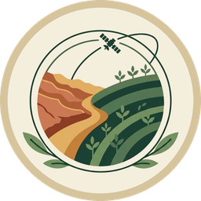
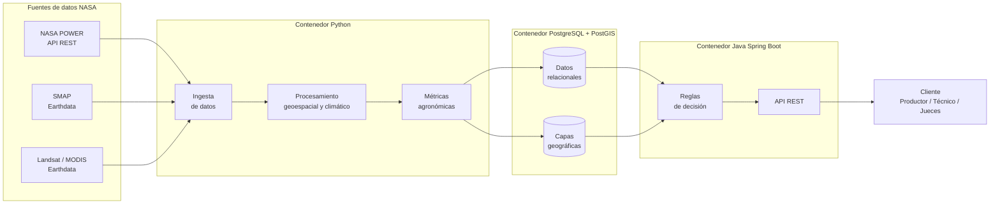

<p align="center"></p>

# TerraShift: Dry Corridor DSS — Field Shift: Adapting Farms with NASA Data

**Español** · [English](README.md)

> Sistema de Apoyo a la Toma de Decisiones (DSS) para comparar estrategias de rotación de cultivos frente a la sequía y la degradación del suelo, usando datos satelitales y climáticos de la NASA.

**NASA Space Apps Challenge 2026** · Reto: *Field Shift: Adapting Farms with NASA Data*
**Equipo:** Los zzz · **Sede:** Managua, Nicaragua
**Caso piloto:** Corredor Seco de Nicaragua (maíz y frijol)

| Estado | Fase |
|---|---|
| Método de comparación de estrategias | **Balance hídrico simple calculado directamente con datos de la NASA** (ver sección 2) |
| Arquitectura y documentación base | Completada |
| Implementación del MVP | **Funcional con datos reales de NASA** para la zona piloto (ver «Estado actual») |

---

## Tabla de contenidos

1. [Resumen ejecutivo e impacto](#1-resumen-ejecutivo-e-impacto)
2. [Metodología: balance hídrico con datos de la NASA](#2-metodología-balance-hídrico-con-datos-de-la-nasa)
3. [Arquitectura del sistema](#3-arquitectura-del-sistema)
4. [Estructura del repositorio](#4-estructura-propuesta-del-repositorio)
5. [Matriz de estrategias de rotación](#5-matriz-de-estrategias-de-rotación)
6. [Roadmap de desarrollo (MVP)](#6-roadmap-de-desarrollo-mvp)
7. [Puesta en marcha](#7-puesta-en-marcha)
8. [Fuentes de datos NASA](#8-fuentes-de-datos-nasa)
9. [Alcance y limitaciones](#9-alcance-y-limitaciones)
10. [Equipo y licencia](#10-equipo-y-licencia)
11. [Declaración de uso de IA](#11-declaración-de-uso-de-ia)

---

## 1. Resumen ejecutivo e impacto

### El problema

El **Corredor Seco** es una franja de bosque tropical seco que atraviesa Centroamérica y abarca buena parte del Pacífico y el centro-norte de Nicaragua. Allí, miles de familias dependen de la agricultura de subsistencia de **granos básicos** (maíz y frijol) cultivada en secano, es decir, sin riego y sujeta al régimen de lluvias.

Los problemas que enfrentan los pequeños productores se refuerzan entre sí:

- **Variabilidad climática creciente:** retrasos en el inicio de la temporada de lluvias, canícula (veranillo) más prolongada y eventos de sequía asociados a El Niño.
- **Degradación del suelo:** pérdida de materia orgánica, erosión y baja retención de humedad, agravadas por prácticas de monocultivo y quema.
- **Información de decisión limitada:** la mayoría de los productores no cuenta con herramientas que traduzcan datos climáticos y satelitales en recomendaciones concretas sobre **qué sembrar, cuándo y con qué prácticas**.
- **Escasez de series históricas hiperlocales abiertas** en el país, lo que dificulta calibrar modelos agronómicos solo con datos nacionales.

### Nuestra solución

TerraShift es un **DSS (Decision Support System)** que cruza datos de observación de la Tierra de la NASA con parámetros edáficos para **comparar, bajo un mismo marco cuantitativo, tres estrategias de rotación de cultivos**: una línea base tradicional, una orientada a la conservación hídrica y una orientada a la regeneración de suelos.

El sistema responde a la pregunta central del productor y del técnico de extensión:

> *Dadas las condiciones climáticas y de suelo de mi zona, ¿qué estrategia de rotación reduce mejor mi riesgo frente a la sequía y mejora la salud de mi suelo a mediano plazo?*

### Cómo usamos los datos de la NASA

| Fuente | Aporte al modelo |
|---|---|
| **NASA POWER** | Precipitación, temperatura, radiación solar y humedad: series climáticas diarias y derivación de índices de sequía y de estrés hídrico. |
| **SMAP** | Humedad de suelo (superficie y zona de raíces): señal directa de disponibilidad de agua para el cultivo. |
| **Landsat / MODIS** | Índices de vegetación (NDVI/EVI), fenología y evapotranspiración: seguimiento del vigor del cultivo y de la cobertura. |

### Estado actual (15 de noviembre de 2026)

**Qué funciona hoy con datos reales de la NASA**

- Ingesta de **NASA POWER** (clima diario), **MODIS** y **Landsat/HLS** (NDVI) y **SMAP** (humedad del suelo) a través del servicio AppEEARS, con sincronización **incremental diaria** (solo pide lo que falta) y registro de cada intento.
- Base de datos PostgreSQL/PostGIS con las series y vistas de **frescura** (hasta qué fecha llega cada fuente) y de **resumen mensual**.
- API REST (Spring Boot) con zonas, estado de los datos y observaciones mensuales; documentada en OpenAPI.
- Página web con menú de zonas, mapa, panel **«Datos de la NASA en este servidor»** (estado por fuente y gráficas de lluvia, humedad del suelo y NDVI) y una **lectura en lenguaje sencillo** de lo observado (lluvia, meses secos, señal compatible con canícula, vigor de la vegetación).
- **Zonas propuestas desde el mapa:** cualquier visitante dibuja un rectángulo y lo envía; el equipo lo aprueba antes de descargar datos.
- **Explicación para el agricultor con reglas fijas:** un resumen de tres líneas y una explicación en lenguaje sencillo que salen de `frontend/interpretacion.json` (unas 120 reglas condicionales y más de 30 recomendaciones). Usan los resultados de E1, E2 y E3, las tendencias de los datos de la NASA y una proyección lineal de la lluvia anual; cada frase muestra el criterio que la activó. No se usa ningún modelo de IA mientras funciona la página.

**Datos NASA cargados en la zona piloto** (cifras del servidor en la fecha indicada; cambian con cada sincronización)

| Fuente | Filas cargadas | Cobertura cargada |
|---|---|---|
| NASA POWER (clima diario) | 4 242 | 2015-04-01 a 2026-11-10 |
| MODIS (NDVI/EVI, 250 m) | 265 | 2015-03-22 a 2026-10-16 |
| Landsat / HLS (NDVI/EVI, 30 m) | 211 | 2015-04-09 a 2026-11-01 |
| SMAP (humedad del suelo) | en carga | la carga inicial se acotó a lo más reciente por los tiempos de espera de la NASA |

**Qué no hace todavía**

- No hay puntaje global de decisión (sección 5.3).
- Los resultados de E1, E2 y E3 son estimaciones del modelo de la sección 2, no mediciones de campo.

---

### Impacto esperado

- **Productor y extensionista:** una comparación clara y trazable entre alternativas de manejo, en lugar de decisiones basadas únicamente en la costumbre o en la intuición.
- **Resiliencia climática:** priorizar prácticas que reduzcan la exposición a la sequía y recuperen la capacidad del suelo para retener agua.
- **Escalabilidad:** la metodología no depende de una sola finca; puede replicarse en otras zonas del Corredor Seco y de Centroamérica incorporando nuevas zonas con sus datos de la NASA.
- **Ciencia abierta:** uso exclusivo de datos abiertos y de código reproducible.

---

## 2. Metodología: balance hídrico con datos de la NASA

La comparación de E1, E2 y E3 se calcula **directamente con las series observadas de la NASA** para la zona (lluvia y temperatura de NASA POWER, más SMAP y NDVI como contraste). Es un modelo **simple y transparente**: un balance de agua diario del suelo con métodos de la FAO, que cualquiera puede revisar y ajustar.

### Pasos del método

```
1. Leer el clima diario observado de la zona   ->  lluvia, temperatura máxima y mínima (NASA POWER)
2. Calcular la demanda de agua                  ->  evapotranspiración de referencia ET0 (Hargreaves-Samani, con Ra de FAO-56)
3. Simular cada ciclo de cultivo, año por año   ->  balance de agua del suelo con coeficientes Kc/Kcb de FAO-56
4. Aplicar el manejo de cada estrategia         ->  E1, E2 y E3 reciben el mismo clima; cambia solo el manejo
5. Convertir el estrés de agua en rendimiento   ->  rendimiento relativo con la función de respuesta de FAO-33
6. Agrupar los años en escenarios                ->  normal, seco y canícula, con media y rango [mín – máx]
7. Contrastar con la señal satelital            ->  NDVI (MODIS/Landsat) y humedad SMAP observados en la zona
```

### 2.1 Balance de agua del suelo

- **Demanda:** `ET0` diaria con Hargreaves-Samani (necesita temperatura máxima, mínima y latitud de la zona); la radiación extraterrestre sale de las ecuaciones de FAO-56.
- **Cultivo:** coeficiente `Kc = Kcb + Ke`, donde `Kcb` es la transpiración del cultivo según su etapa (inicial, desarrollo, media, final) y `Ke` la evaporación del suelo descubierto. Maíz: siembra de primera (mayo); frijol: siembra de postrera (septiembre).
- **Suelo:** un depósito de agua con capacidad `TAW` (agua útil para las raíces). La lluvia lo llena, la evaporación y la transpiración lo vacían, y el exceso se pierde. Cuando el agua disponible baja de la fracción tolerable `p`, aparece estrés (`Ks < 1`).
- **Rendimiento relativo:** `1 − Ky · (1 − Ta/Tc)`, donde `Ta/Tc` es la transpiración real frente a la potencial del ciclo y `Ky` la sensibilidad del cultivo (FAO-33).

### 2.2 Cómo se diferencian E1, E2 y E3

Las tres estrategias reciben **exactamente la misma lluvia y temperatura**. Solo cambian tres parámetros de manejo, que están a la vista en `python-etl/src/metrics/strategies.py`:

| Parámetro | E1 · Línea base | E2 · Conservación hídrica | E3 · Regeneración de suelos |
|---|---|---|---|
| Escorrentía (fracción de la lluvia que se pierde) | 0,15 | 0,08 (barreras, curvas a nivel) | 0,12 |
| Factor de evaporación del suelo | 1,00 (suelo descubierto) | 0,85 (cobertura con rastrojo) | 1,00 |
| Capacidad de agua del suelo (`TAW`) | ×1,00 | ×1,00 | ×1,10 (más materia orgánica) |

Estos valores son **supuestos explícitos del modelo**; se pueden modificar para hacer un análisis de sensibilidad y ver cuánto cambia el resultado.

### 2.3 Escenarios con años realmente observados

No se usan proyecciones: los escenarios se arman con los años de la serie de NASA POWER de la zona.

| Escenario | Definición | Datos usados |
|---|---|---|
| Año normal | Años intermedios (tercio central) por lluvia del ciclo | Lluvia diaria de NASA POWER |
| Año seco | Los 3 años con menos lluvia en el ciclo del cultivo | Lluvia diaria de NASA POWER |
| Canícula prolongada | Los 3 años con menos lluvia en julio–agosto | Lluvia diaria de NASA POWER |

Para cada escenario se reporta la **media** y el rango `[mín – máx]` de los años que lo forman. Los años con datos incompletos se descartan.

### 2.4 Contraste con otras fuentes NASA

- **NDVI (MODIS y Landsat/HLS):** el vigor de la vegetación observado en años secos y normales debe moverse en el mismo sentido que el estrés calculado.
- **Humedad del suelo (SMAP):** referencia de la humedad real de la zona cuando su carga termina.
- **Sensibilidad:** al cambiar los parámetros de la tabla 2.2 se ve si el orden de las estrategias se mantiene.

---

## 3. Arquitectura del sistema

Sistema híbrido, encapsulado en contenedores **Docker** y orquestado con **Docker Compose**. Cada servicio tiene una responsabilidad única y se comunica con los demás por interfaces explícitas.

### Diagrama de flujo



### Responsabilidades por servicio

| Servicio | Tecnología | Responsabilidad |
|---|---|---|
| `python-etl` | Python 3.11+ | Ingesta de las APIs de la NASA, limpieza, procesamiento geoespacial y climático, cálculo de métricas agronómicas y carga a la base de datos. |
| `java-backend` | Java 21 + Spring Boot | Lógica de negocio, motor de reglas de decisión, comparación de estrategias, exposición de la API REST y gestión de datos. |
| `database` | PostgreSQL + PostGIS | Almacenamiento de datos relacionales (parcelas, estrategias, resultados) y capas geográficas (zonas, rasters vectorizados, límites). |

### Contrato entre servicios

- **ETL → Base de datos:** el ETL es el **único** servicio que escribe en las tablas de datos crudos y de métricas (`raw_*`, `metrics_*`). Las cargas son idempotentes.
- **Backend → Base de datos:** el backend **lee** métricas y **escribe** únicamente resultados de comparación y datos de aplicación (`app_*`).
- **Backend → Cliente:** API REST documentada con OpenAPI/Swagger (`/docs/api`).
- Los servicios no se llaman entre sí directamente: **la base de datos es el punto de integración**. Esto permite que el equipo desarrolle ETL y backend en paralelo.

### Modelo de datos (borrador)

| Tabla | Contenido |
|---|---|
| `zone` | Zona/municipio del piloto (geometría PostGIS). |
| `climate_daily` | Serie diaria de variables climáticas por zona (origen NASA POWER). |
| `soil_moisture` | Humedad de suelo por zona y fecha (origen SMAP). |
| `vegetation_index` | NDVI/EVI por zona y fecha (origen Landsat/MODIS). |
| `soil_profile` | Parámetros edáficos por zona. |
| `crop` | maíz, frijol y parámetros de ciclo. |
| `strategy` | Las 3 estrategias de rotación y su definición. |
| `strategy_result` | Resultado de cada estrategia por zona y escenario. |

---

## 4. Estructura propuesta del repositorio

```
TerraShift/
├── README.md
├── docker-compose.yml
├── .env.example
├── .gitignore
│
├── python-etl/                 # Motor analítico / ETL
│   ├── Dockerfile
│   ├── pyproject.toml
│   ├── src/
│   │   ├── ingest/             # Clientes NASA POWER, SMAP, Landsat/MODIS
│   │   ├── process/            # Limpieza, geoprocesamiento, índices de sequía
│   │   ├── metrics/            # Métricas agronómicas por estrategia
│   │   └── load/               # Carga idempotente a PostgreSQL/PostGIS
│   └── tests/
│
├── java-backend/               # Backend core (Spring Boot)
│   ├── Dockerfile
│   ├── pom.xml
│   └── src/
│       ├── main/java/.../
│       │   ├── api/            # Controladores REST
│       │   ├── domain/         # Entidades y reglas de decisión
│       │   ├── service/        # Comparación de estrategias
│       │   └── repository/     # Acceso a datos
│       └── test/
│
├── database/                   # Base de datos
│   ├── init/                   # Scripts SQL de inicialización (esquema, PostGIS)
│   ├── migrations/             # Migraciones versionadas
│   └── seeds/                  # Datos semilla (cultivos y estrategias)
│
├── data/                       # Datos locales (ignorado por git, salvo muestras)
│   └── samples/
│
└── docs/                       # Documentación
    ├── manual-de-usuario.md    # Cómo usar la página, zonas y sus limitaciones
    ├── metodologia.md          # Detalle del método de balance hídrico
    ├── referencias.md          # Bibliografía y fuentes verificables
    ├── api/                    # Especificación OpenAPI
    ├── arquitectura/           # Decisiones de diseño
    └── img/                    # Diagramas y capturas
```

**Convenciones del equipo**

- Una rama por funcionalidad: `feat/etl-power`, `feat/api-estrategias`, `fix/...`.
- Pull requests pequeños y revisados por al menos otra persona.
- Ningún secreto en el repositorio: credenciales de NASA Earthdata y de la base de datos van en `.env` (ver `.env.example`).

---

## 5. Matriz de estrategias de rotación

Las tres estrategias se evalúan con **los mismos indicadores y los mismos escenarios climáticos** (año normal, año seco, año con canícula prolongada), de modo que la comparación sea justa.

### 5.1 Definición de las estrategias

| | **E1 · Línea base tradicional** | **E2 · Conservación hídrica** | **E3 · Regeneración de suelos** |
|---|---|---|---|
| **Enfoque** | Práctica actual del productor. | Maximizar el aprovechamiento y retención de agua. | Recuperar materia orgánica y estructura del suelo. |
| **Rotación / secuencia** | Maíz en primera (mayo–agosto) y frijol en postrera (septiembre–diciembre). | La misma secuencia, con cobertura y obras de conservación. | Maíz y frijol alternados con una leguminosa de cobertura (abono verde). |
| **Prácticas clave** | Labranza convencional, suelo desnudo en la época seca, sin obras de conservación. | Labranza mínima, cobertura del suelo con rastrojo, barreras vivas o curvas a nivel. | Abonos verdes, aporte de materia orgánica (compost, estiércol), sin quema. |
| **Cómo entra en el modelo** | Escorrentía 0,15 · evaporación ×1,00 · agua útil ×1,00 | Escorrentía 0,08 · evaporación ×0,85 · agua útil ×1,00 | Escorrentía 0,12 · evaporación ×1,00 · agua útil ×1,10 |

> Las prácticas son una definición de trabajo basada en prácticas ampliamente documentadas para el Corredor Seco; sus efectos entran al modelo como los parámetros de la sección 2.2.

### 5.2 Matriz comparativa de resultados

La matriz se calcula con `python -m src.cli metrics --zone <zona>` a partir de la serie de NASA POWER de la zona, se guarda en la tabla `strategy_result` y se muestra en la página como una **tabla lado a lado** (cultivo × escenario × indicador, con la mejor estrategia de cada fila resaltada). Cada valor se reporta como media y rango `[mín – máx]`.

| Indicador | Unidad | Fuente principal | Mejor es |
|---|---|---|---|
| Rendimiento relativo (% del potencial) | % | NASA POWER + balance hídrico | Mayor |
| Índice de estrés hídrico | 0–1 | NASA POWER + balance hídrico | Menor |
| Déficit de transpiración del ciclo | mm | NASA POWER + balance hídrico | Menor |
| Lluvia efectiva del ciclo | mm | NASA POWER | Mayor |

Cada indicador se calcula para **E1, E2 y E3**, para **maíz y frijol** y para los **tres escenarios** (72 valores por zona). Los números dependen de la zona y de la serie cargada, por eso se leen en la página y no se fijan en este documento.

#### Datos NASA observados que acompañan la comparación (zona piloto)

| Dato | Fuente | Dónde se ve |
|---|---|---|
| Lluvia mensual y días con lluvia | NASA POWER | Panel de datos NASA y `GET /api/v1/zones/{zona}/observations/monthly` |
| Temperatura media mensual | NASA POWER | Misma API |
| Humedad del suelo (superficie y zona de raíces) | SMAP | Panel de datos NASA (cuando la carga de SMAP termina) |
| Vigor de la vegetación (NDVI) | MODIS y Landsat/HLS | Panel de datos NASA |
| Lectura automática: meses secos, señal de canícula, NDVI frente al año anterior | Derivada de lo anterior | Panel «Lectura de los datos» |

### 5.3 Regla de decisión (borrador)

El backend calcula un **puntaje global** como suma ponderada de indicadores normalizados:

```
puntaje(E) = Σ  w_i × indicador_normalizado_i(E)
```

- Los pesos `w_i` son **configurables** (por ejemplo: priorizar resiliencia a la sequía frente a costo).
- Pesos por defecto: pendiente. El puntaje global **no está implementado** en el MVP; la comparación se hace indicador por indicador (sección 5.2).

---

## 6. Roadmap de desarrollo (MVP)

Prioridad: tener un **flujo completo de extremo a extremo** (aunque simple) lo antes posible, y luego profundizar.

### Fase 0 · Cimientos
- [ ] Definir convenciones de ramas y revisión de código
- [x] Crear `docker-compose.yml` con los tres servicios y red compartida
- [x] Crear `.env.example` y documentar variables de entorno
- [x] Registrar cuenta en NASA Earthdata y compartir el método de credenciales con el equipo
- [ ] Verificar que `docker compose up` levanta los tres contenedores vacíos

### Fase 1 · Base de datos
- [x] Contenedor PostgreSQL con extensión PostGIS habilitada
- [x] Esquema inicial (`zone`, `climate_daily`, `soil_moisture`, `vegetation_index`, `soil_profile`, `crop`, `strategy`, `strategy_result`)
- [x] Datos semilla: cultivos y las 3 estrategias
- [x] Definir y cargar la geometría de la(s) zona(s) piloto

### Fase 2 · Motor analítico (Python)
- [x] Cliente de NASA POWER (serie diaria por zona)
- [x] Cliente de SMAP (humedad de suelo)
- [x] Cliente de Landsat/MODIS (NDVI/EVI)
- [x] Limpieza y agregación temporal/espacial
- [x] Índices de sequía básicos (racha seca más larga, totales mensuales)
- [x] Índice de estrés hídrico del cultivo (balance hídrico FAO-56)
- [x] Sincronización incremental diaria de las cuatro fuentes
- [x] Cálculo de métricas de E1, E2 y E3 con datos de NASA POWER (`cli metrics`)
- [x] Carga idempotente a PostgreSQL/PostGIS
- [x] Pruebas unitarias de las métricas clave

### Fase 3 · Backend (Spring Boot)
- [x] Proyecto base con conexión a PostgreSQL/PostGIS
- [x] Entidades y repositorios
- [ ] Motor de reglas: puntaje global ponderado
- [x] Endpoints REST: zonas, series, estrategias, comparación
- [x] Documentación OpenAPI/Swagger
- [x] Pruebas de los endpoints principales

### Fase 4 · Visualización y demo
- [x] Interfaz mínima que consuma la API (menú de zonas, tabla comparativa de E1, E2 y E3 y tarjetas por estrategia)
- [x] Panel de datos NASA con lectura en lenguaje sencillo y zonas propuestas desde el mapa
- [x] Mapa de la zona elegida y para proponer zonas nuevas
- [ ] Capa de índice de vegetación o humedad sobre el mapa
- [ ] Gráficas comparativas por escenario (normal / seco / canícula)
- [x] Mostrar el rango [mín – máx] y los supuestos detrás de cada resultado

### Fase 5 · Cierre y entrega
- [ ] Ejecutar `cli metrics` en el servidor y revisar los resultados finales de la zona piloto
- [ ] Completar `docs/referencias.md` con todas las fuentes
- [ ] Capturas, diagramas finales y video/guion de la demo
- [x] Revisar que el README refleje el estado real del proyecto
- [ ] Ensayo de la presentación y envío del proyecto en la plataforma de Space Apps

> **Regla de corte:** si el tiempo se agota, el MVP mínimo defendible es **Fases 0, 1, 2 y 3** con una **comparación visible de las 3 estrategias** (aunque sea con una interfaz muy simple).

---

## 7. Puesta en marcha

> Para desplegar en un servidor (servicio, Nginx, HTTPS, sincronización diaria) ver [`deploy/README.md`](deploy/README.md). El manual para quien usa la página está en [`docs/manual-de-usuario.md`](docs/manual-de-usuario.md).

```bash
# 1. Clonar
git clone https://github.com/Rrodrovan/TerraShift.git
cd TerraShift

# 2. Configurar variables de entorno
cp .env.example .env
# Editar .env con credenciales de NASA Earthdata y de la base de datos

# 3. Levantar todos los servicios
docker compose up --build

# 4. Descargar los datos de la NASA (incremental; la primera vez puede tardar horas)
docker compose run --rm python-etl python -m src.cli sync --all-zones

# 5. Consultar la API
curl http://localhost:8080/api/v1/strategies/compare?zone=piloto
```

**Variables de entorno previstas**

| Variable | Descripción |
|---|---|
| `POSTGRES_DB` / `POSTGRES_USER` / `POSTGRES_PASSWORD` | Credenciales de la base de datos. |
| `EARTHDATA_USERNAME` / `EARTHDATA_PASSWORD` | Credenciales de NASA Earthdata (SMAP, Landsat/MODIS). |
| `PILOT_ZONE_BBOX` | Caja geográfica de la zona piloto. |
| `ETL_START_DATE` / `ETL_END_DATE` | Rango temporal de ingesta (la fecha de inicio solo aplica a fuentes sin datos previos). |
| `TERRASHIFT_ADMIN_TOKEN` | Token para aprobar zonas propuestas; sin él, las funciones de administración quedan desactivadas. |

---

## 8. Fuentes de datos NASA

| Fuente | Qué aporta | Acceso |
|---|---|---|
| NASA POWER | Meteorología y radiación solar diaria en cuadrícula global | API REST pública |
| SMAP | Humedad de suelo (superficie y zona de raíces) | NASA Earthdata (requiere cuenta) |
| Landsat | Reflectancia superficial a 30 m (NDVI) | NASA Earthdata / USGS |
| MODIS | Índices de vegetación y evapotranspiración | NASA Earthdata (LP DAAC) |

Todos los datos de NASA se usan conforme a sus políticas de datos abiertos, con la atribución correspondiente.

---

## 9. Alcance y limitaciones

Esta sección separa lo que el proyecto **sí hace** de lo que **no hace**, y para cada limitación indica su impacto y cómo la mitigamos.

### 9.1 Alcance

| Dimensión | Dentro del alcance (MVP) | Fuera del alcance (por ahora) |
|---|---|---|
| **Territorio** | Corredor Seco de Nicaragua, zona(s) piloto | Otros países o regiones húmedas |
| **Cultivos** | maíz y frijol | Hortalizas, café, frutales, ganadería |
| **Estrategias** | Las 3 estrategias de rotación definidas (sección 5) | Otras prácticas de manejo |
| **Escala espacial** | Zona / municipio | Parcela individual |
| **Datos** | NASA POWER, SMAP y Landsat/MODIS | Datos de campo propios de productores |
| **Resultado** | Comparación cuantitativa con rango [mín – máx] | Recomendaciones agronómicas personalizadas o prescriptivas |
| **Usuarios** | Técnicos de extensión, productores asistidos y evaluadores | Uso comercial o certificación |

### 9.2 Limitaciones, impacto y mitigación

| # | Limitación | Impacto en los resultados | Mitigación |
|---|---|---|---|
| L1 | No hay series históricas hiperlocales abiertas en Nicaragua | El modelo no se calibra con ensayos locales | Se usan solo datos de la NASA, con métodos estándar de la FAO y supuestos a la vista |
| L2 | Los efectos de manejo de E1, E2 y E3 son parámetros del modelo | Los resultados dependen de esos supuestos | Parámetros explícitos y ajustables (sección 2.2) para hacer análisis de sensibilidad |
| L3 | SMAP tiene resolución gruesa (decenas de km) | No distingue diferencias entre parcelas vecinas | Trabajar a escala de zona y complementar con NDVI de Landsat/MODIS |
| L4 | El suelo se representa con un valor genérico (franco, 0,15 m³/m³ de agua útil) | Menor precisión en retención de agua de la zona | Reportar rangos y permitir ajustar el parámetro |
| L5 | Los resultados son estimaciones, no mediciones | Pueden no reflejar un año o finca concreta | Rango [mín – máx] en cada resultado |
| L6 | La serie de NASA POWER cubre pocos años | Cada escenario se arma con pocos años (3) | Se reporta el rango de los años y se contrasta con NDVI/SMAP |
| L7 | Las colas de AppEEARS son largas | La primera descarga de SMAP, MODIS y Landsat tarda horas y se acotó a lo reciente | Sincronización incremental que reutiliza tareas ya enviadas y se reintenta cada día |
| L8 | Cada zona se descarga como un rectángulo | No se pueden delimitar terrenos de forma irregular | Dibujar el rectángulo que contenga el terreno; se explica en el manual de usuario |

### 9.3 Uso responsable

- TerraShift es una herramienta de **apoyo a la decisión**, no sustituye la asesoría de un técnico agrónomo.
- Todo resultado muestra su rango y los supuestos que lo producen.

### 9.4 Trabajo futuro

- Incorporar datos de campo de productores y calibrar los parámetros de manejo.
- Validar con ensayos locales en el Corredor Seco.
- Ampliar a otros cultivos y países de la región.

---

## 10. Equipo y licencia

**Equipo "Los zzz"** — sede Managua, Nicaragua.

| Integrante | Rol |
|---|---|
| `Rodrigo Ivan Ramírez Dávalos` | `Desarrollador` |
| `Claudio Antonio De La Rocha Acevedo` | `Marketing` |
| `Teresa Elizabeth Vallecillo Herrera` | `Comunicadora` |
| `Moises Abraham Valle Alonso` | `Product Manager` |

**Licencia:** `[Espacio para las licencias]`

---

## 11. Declaración de uso de IA

Uso de superinteligencia (SI) en este proyecto, según lo pide NASA Space Apps:

- **Qué se hizo con ayuda de IA:** Claude (Anthropic) se usó como asistente de programación y redacción. Ayudó a escribir y revisar partes del código fuente (canalización de datos, API y página web), la documentación, los textos de las reglas de interpretación (`frontend/interpretacion.json`) y los textos de la presentación. El equipo dirigió, ejecutó y probó el resultado.
- **Dentro del producto:** ningún modelo de IA se ejecuta en TerraShift. La interpretación que ve el agricultor sale de reglas fijas y transparentes.
- **Datos:** todos los datos vienen de fuentes de la NASA; ningún dato fue generado por IA.
- **Logo:** [completar: quién lo hizo y si se generó con una herramienta de IA; en ese caso debe llevar una marca visible de "generado con IA"].

---

*NASA Space Apps Challenge 2026. Este proyecto fue desarrollado en el marco del hackathon y no está afiliado ni respaldado oficialmente por la NASA.*
