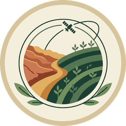
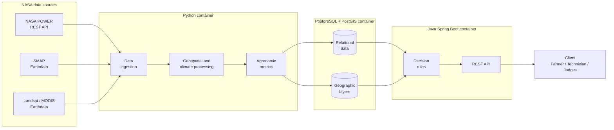

<p align="center"></p>

# TerraShift: Dry Corridor DSS — Field Shift: Adapting Farms with NASA Data

**English** · [Español](README.es.md)

> A Decision Support System (DSS) that compares crop rotation strategies against drought and soil degradation, using NASA satellite and climate data.

**NASA Space Apps Challenge 2026** · Challenge: *Field Shift: Adapting Farms with NASA Data*
**Team:** Los zzz · **Location:** Managua, Nicaragua
**Pilot case:** Nicaragua's Dry Corridor (maize and beans)

| Status | Phase |
|---|---|
| Strategy comparison method | **Simple water balance computed directly from NASA data** (see section 2) |
| Architecture and base documentation | Completed |
| MVP implementation | **Working with real NASA data** for the pilot zone (see "Current status") |

---

## Table of contents

1. [Executive summary and impact](#1-executive-summary-and-impact)
2. [Methodology: water balance with NASA data](#2-methodology-water-balance-with-nasa-data)
3. [System architecture](#3-system-architecture)
4. [Repository structure](#4-proposed-repository-structure)
5. [Rotation strategy matrix](#5-rotation-strategy-matrix)
6. [Development roadmap (MVP)](#6-development-roadmap-mvp)
7. [Getting started](#7-getting-started)
8. [NASA data sources](#8-nasa-data-sources)
9. [Scope and limitations](#9-scope-and-limitations)
10. [Team and license](#10-team-and-license)
11. [Statement on the use of AI](#11-statement-on-the-use-of-ai)

> The user manual and the detailed methodology in `docs/` are written in Spanish.

---

## 1. Executive summary and impact

### The problem

The **Dry Corridor** is a strip of tropical dry forest that crosses Central America and covers much of Nicaragua's Pacific region and north-central area. Thousands of families there depend on subsistence farming of **staple grains** (maize and beans) grown under rainfed conditions, that is, without irrigation and at the mercy of the rainfall regime.

The problems faced by smallholder farmers reinforce each other:

- **Growing climate variability:** late starts of the rainy season, a longer mid-summer dry spell (*canícula*) and droughts linked to El Niño.
- **Soil degradation:** loss of organic matter, erosion and low moisture retention, made worse by monoculture and burning.
- **Limited decision information:** most farmers have no tools that turn climate and satellite data into concrete recommendations on **what to plant, when and with which practices**.
- **Scarcity of open, hyperlocal historical series** in the country, which makes it hard to calibrate agronomic models with national data alone.

### Our solution

TerraShift is a **DSS (Decision Support System)** that combines NASA Earth observation data with soil parameters to **compare, under a single quantitative framework, three crop rotation strategies**: a traditional baseline, one focused on water conservation and one focused on soil regeneration.

The system answers the central question of the farmer and the extension technician:

> *Given the climate and soil conditions of my zone, which rotation strategy best reduces my drought risk and improves the health of my soil in the medium term?*

### How we use NASA data

| Source | Contribution to the model |
|---|---|
| **NASA POWER** | Precipitation, temperature, solar radiation and humidity: daily climate series and derived drought and water-stress indices. |
| **SMAP** | Soil moisture (surface and root zone): a direct signal of the water available to the crop. |
| **Landsat / MODIS** | Vegetation indices (NDVI/EVI), phenology and evapotranspiration: monitoring of crop vigor and ground cover. |

### Current status (November 15, 2026)

**What works today with real NASA data**

- Ingestion of **NASA POWER** (daily climate), **MODIS** and **Landsat/HLS** (NDVI) and **SMAP** (soil moisture) through the AppEEARS service, with **daily incremental synchronization** (it only requests what is missing) and a log of every attempt.
- PostgreSQL/PostGIS database with the series and with **freshness** (how recent each source is) and **monthly summary** views.
- REST API (Spring Boot) with zones, data status and monthly observations, documented in OpenAPI.
- Web page with a zone menu, a map, a **"NASA data on this server"** panel (status per source and charts of rainfall, soil moisture and NDVI) and a **plain-language reading** of what was observed (rainfall, dry months, a signal consistent with a dry spell, vegetation vigor).
- **Zones proposed from the map:** any visitor draws a rectangle and submits it; the team approves it before any data is downloaded.
- **Explanation for the farmer from fixed rules:** a three-line summary and a plain-language explanation produced from `frontend/interpretacion.json` (about 120 conditional rules and more than 30 recommendations). They use the results of E1, E2 and E3, the trends in the NASA data and a linear projection of annual rainfall; every sentence shows the criterion that triggered it. No AI model runs while the page is working.

**NASA data loaded for the pilot zone** (server figures on the date shown; they change with every synchronization)

| Source | Rows loaded | Coverage loaded |
|---|---|---|
| NASA POWER (daily climate) | 4,242 | 2015-04-01 to 2026-11-10 |
| MODIS (NDVI/EVI, 250 m) | 265 | 2015-03-22 to 2026-10-16 |
| Landsat / HLS (NDVI/EVI, 30 m) | 211 | 2015-04-09 to 2026-11-01 |
| SMAP (soil moisture) | loading | the initial load was limited to the most recent data because of NASA queue times |

**What it does not do yet**

- There is no overall decision score (section 5.3).
- The results for E1, E2 and E3 are estimates from the model in section 2, not field measurements.

---

### Expected impact

- **Farmers and extension workers:** a clear, traceable comparison between management alternatives, instead of decisions based only on habit or intuition.
- **Climate resilience:** prioritizing practices that reduce exposure to drought and restore the soil's capacity to hold water.
- **Scalability:** the methodology does not depend on a single farm; it can be replicated in other zones of the Dry Corridor and of Central America by adding new zones with their NASA data.
- **Open science:** exclusive use of open data and reproducible code.

---

## 2. Methodology: water balance with NASA data

The comparison of E1, E2 and E3 is computed **directly from the observed NASA series** for the zone (rainfall and temperature from NASA POWER, plus SMAP and NDVI as a cross-check). It is a **simple and transparent** model: a daily soil water balance using FAO methods that anyone can review and adjust.

### Method steps

```
1. Read the observed daily climate of the zone  ->  rainfall, maximum and minimum temperature (NASA POWER)
2. Compute the water demand                      ->  reference evapotranspiration ET0 (Hargreaves-Samani, with Ra from FAO-56)
3. Simulate each crop cycle, year by year        ->  soil water balance with FAO-56 Kc/Kcb coefficients
4. Apply each strategy's management              ->  E1, E2 and E3 get the same climate; only the management changes
5. Turn water stress into yield                  ->  relative yield with the FAO-33 response function
6. Group the years into scenarios                ->  normal, dry and canícula, with mean and range [min – max]
7. Cross-check with the satellite signal         ->  NDVI (MODIS/Landsat) and SMAP moisture observed in the zone
```

### 2.1 Soil water balance

- **Demand:** daily `ET0` with Hargreaves-Samani (it needs maximum and minimum temperature and the latitude of the zone); extraterrestrial radiation comes from the FAO-56 equations.
- **Crop:** coefficient `Kc = Kcb + Ke`, where `Kcb` is crop transpiration by stage (initial, development, mid, late) and `Ke` is evaporation from bare soil. Maize: first-season planting (May); beans: second-season (*postrera*) planting (September).
- **Soil:** a water reservoir with capacity `TAW` (water available to the roots). Rain fills it, evaporation and transpiration empty it, and the excess is lost. When the available water falls below the tolerable fraction `p`, stress appears (`Ks < 1`).
- **Relative yield:** `1 − Ky · (1 − Ta/Tc)`, where `Ta/Tc` is actual versus potential transpiration over the cycle and `Ky` is the crop's sensitivity (FAO-33).

### 2.2 How E1, E2 and E3 differ

The three strategies receive **exactly the same rainfall and temperature**. Only three management parameters change, and they are visible in `python-etl/src/metrics/strategies.py`:

| Parameter | E1 · Baseline | E2 · Water conservation | E3 · Soil regeneration |
|---|---|---|---|
| Runoff (fraction of rainfall that is lost) | 0.15 | 0.08 (barriers, contour lines) | 0.12 |
| Soil evaporation factor | 1.00 (bare soil) | 0.85 (stubble cover) | 1.00 |
| Soil water capacity (`TAW`) | ×1.00 | ×1.00 | ×1.10 (more organic matter) |

These values are **explicit model assumptions**; they can be changed to run a sensitivity analysis and see how much the result moves.

### 2.3 Scenarios built from years that were actually observed

No projections are used: the scenarios are built from the years of the zone's NASA POWER series.

| Scenario | Definition | Data used |
|---|---|---|
| Normal year | Intermediate years (middle third) by cycle rainfall | NASA POWER daily rainfall |
| Dry year | The 3 years with the least rainfall during the crop cycle | NASA POWER daily rainfall |
| Prolonged canícula | The 3 years with the least rainfall in July–August | NASA POWER daily rainfall |

For each scenario the **mean** and the range `[min – max]` of the years that make it up are reported. Years with incomplete data are discarded.

### 2.4 Cross-check with other NASA sources

- **NDVI (MODIS and Landsat/HLS):** the vegetation vigor observed in dry and normal years should move in the same direction as the computed stress.
- **Soil moisture (SMAP):** a reference for the real moisture of the zone once its load finishes.
- **Sensitivity:** changing the parameters in table 2.2 shows whether the ranking of the strategies holds.

---

## 3. System architecture

A hybrid system, packaged in **Docker** containers and orchestrated with **Docker Compose**. Each service has a single responsibility and talks to the others through explicit interfaces.

### Flow diagram



### Responsibilities per service

| Service | Technology | Responsibility |
|---|---|---|
| `python-etl` | Python 3.11+ | Ingestion from the NASA APIs, cleaning, geospatial and climate processing, computation of agronomic metrics and loading into the database. |
| `java-backend` | Java 21 + Spring Boot | Business logic, decision rule engine, strategy comparison, REST API and data management. |
| `database` | PostgreSQL + PostGIS | Storage of relational data (plots, strategies, results) and geographic layers (zones, vectorized rasters, boundaries). |

### Contract between services

- **ETL → Database:** the ETL is the **only** service that writes to the raw-data and metrics tables (`raw_*`, `metrics_*`). Loads are idempotent.
- **Backend → Database:** the backend **reads** metrics and **writes** only comparison results and application data (`app_*`).
- **Backend → Client:** a REST API documented with OpenAPI/Swagger (`/docs/api`).
- The services do not call each other directly: **the database is the integration point**. This lets the team develop the ETL and the backend in parallel.

### Data model (draft)

| Table | Content |
|---|---|
| `zone` | Pilot zone/municipality (PostGIS geometry). |
| `climate_daily` | Daily series of climate variables per zone (source: NASA POWER). |
| `soil_moisture` | Soil moisture per zone and date (source: SMAP). |
| `vegetation_index` | NDVI/EVI per zone and date (source: Landsat/MODIS). |
| `soil_profile` | Soil parameters per zone. |
| `crop` | Maize, beans and cycle parameters. |
| `strategy` | The 3 rotation strategies and their definition. |
| `strategy_result` | Result of each strategy per zone and scenario. |

---

## 4. Proposed repository structure

```
TerraShift/
├── README.md
├── README.es.md
├── docker-compose.yml
├── .env.example
├── .gitignore
│
├── python-etl/                 # Analytical engine / ETL
│   ├── Dockerfile
│   ├── pyproject.toml
│   ├── src/
│   │   ├── ingest/             # NASA POWER, SMAP, Landsat/MODIS clients
│   │   ├── process/            # Cleaning, geoprocessing, drought indices
│   │   ├── metrics/            # Agronomic metrics per strategy
│   │   └── load/               # Idempotent load into PostgreSQL/PostGIS
│   └── tests/
│
├── java-backend/               # Core backend (Spring Boot)
│   ├── Dockerfile
│   ├── pom.xml
│   └── src/
│       ├── main/java/.../
│       │   ├── api/            # REST controllers
│       │   ├── domain/         # Entities and decision rules
│       │   ├── service/        # Strategy comparison
│       │   └── repository/     # Data access
│       └── test/
│
├── database/                   # Database
│   ├── init/                   # SQL initialization scripts (schema, PostGIS)
│   ├── migrations/             # Versioned migrations
│   └── seeds/                  # Seed data (crops and strategies)
│
├── data/                       # Local data (git-ignored, except samples)
│   └── samples/
│
└── docs/                       # Documentation (in Spanish)
    ├── manual-de-usuario.md    # How to use the page, zones and their limitations
    ├── metodologia.md          # Detail of the water balance method
    ├── referencias.md          # Bibliography and verifiable sources
    ├── api/                    # OpenAPI specification
    ├── arquitectura/           # Design decisions
    └── img/                    # Diagrams and screenshots
```

**Team conventions**

- One branch per feature: `feat/etl-power`, `feat/api-estrategias`, `fix/...`.
- Small pull requests, reviewed by at least one other person.
- No secrets in the repository: NASA Earthdata and database credentials go in `.env` (see `.env.example`).

---

## 5. Rotation strategy matrix

The three strategies are evaluated with **the same indicators and the same climate scenarios** (normal year, dry year, year with a prolonged canícula), so that the comparison is fair.

### 5.1 Definition of the strategies

| | **E1 · Traditional baseline** | **E2 · Water conservation** | **E3 · Soil regeneration** |
|---|---|---|---|
| **Focus** | The farmer's current practice. | Maximize water use and retention. | Restore organic matter and soil structure. |
| **Rotation / sequence** | Maize in the first season (May–August) and beans in the second (September–December). | The same sequence, with ground cover and conservation works. | Maize and beans alternated with a cover legume (green manure). |
| **Key practices** | Conventional tillage, bare soil in the dry season, no conservation works. | Minimum tillage, soil cover with stubble, living barriers or contour lines. | Green manures, organic matter inputs (compost, manure), no burning. |
| **How it enters the model** | Runoff 0.15 · evaporation ×1.00 · available water ×1.00 | Runoff 0.08 · evaporation ×0.85 · available water ×1.00 | Runoff 0.12 · evaporation ×1.00 · available water ×1.10 |

> The practices are a working definition based on practices widely documented for the Dry Corridor; their effects enter the model as the parameters in section 2.2.

### 5.2 Comparative results matrix

The matrix is computed with `python -m src.cli metrics --zone <zone>` from the zone's NASA POWER series, stored in the `strategy_result` table and shown on the page as a **side-by-side table** (crop × scenario × indicator, with the best strategy of each row highlighted). Each value is reported as a mean and a range `[min – max]`.

| Indicator | Unit | Main source | Best is |
|---|---|---|---|
| Relative yield (% of potential) | % | NASA POWER + water balance | Higher |
| Water stress index | 0–1 | NASA POWER + water balance | Lower |
| Transpiration deficit of the cycle | mm | NASA POWER + water balance | Lower |
| Effective rainfall of the cycle | mm | NASA POWER | Higher |

Each indicator is computed for **E1, E2 and E3**, for **maize and beans** and for the **three scenarios** (72 values per zone). The numbers depend on the zone and on the loaded series, so they are read on the page and not fixed in this document.

#### Observed NASA data that accompany the comparison (pilot zone)

| Data | Source | Where it is shown |
|---|---|---|
| Monthly rainfall and rainy days | NASA POWER | NASA data panel and `GET /api/v1/zones/{zone}/observations/monthly` |
| Mean monthly temperature | NASA POWER | Same API |
| Soil moisture (surface and root zone) | SMAP | NASA data panel (once the SMAP load finishes) |
| Vegetation vigor (NDVI) | MODIS and Landsat/HLS | NASA data panel |
| Automatic reading: dry months, canícula signal, NDVI versus the previous year | Derived from the above | "Reading of the data" panel |

### 5.3 Decision rule (draft)

The backend computes an **overall score** as a weighted sum of normalized indicators:

```
score(E) = Σ  w_i × normalized_indicator_i(E)
```

- The weights `w_i` are **configurable** (for example: prioritize drought resilience over cost).
- Default weights: pending. The overall score is **not implemented** in the MVP; the comparison is made indicator by indicator (section 5.2).

---

## 6. Development roadmap (MVP)

Priority: have a **complete end-to-end flow** (even a simple one) as soon as possible, and then go deeper.

### Phase 0 · Foundations
- [ ] Define branch and code review conventions
- [x] Create `docker-compose.yml` with the three services and a shared network
- [x] Create `.env.example` and document the environment variables
- [x] Register a NASA Earthdata account and share the credentials method with the team
- [ ] Check that `docker compose up` starts the three empty containers

### Phase 1 · Database
- [x] PostgreSQL container with the PostGIS extension enabled
- [x] Initial schema (`zone`, `climate_daily`, `soil_moisture`, `vegetation_index`, `soil_profile`, `crop`, `strategy`, `strategy_result`)
- [x] Seed data: crops and the 3 strategies
- [x] Define and load the geometry of the pilot zone(s)

### Phase 2 · Analytical engine (Python)
- [x] NASA POWER client (daily series per zone)
- [x] SMAP client (soil moisture)
- [x] Landsat/MODIS client (NDVI/EVI)
- [x] Cleaning and temporal/spatial aggregation
- [x] Basic drought indices (longest dry spell, monthly totals)
- [x] Crop water stress index (FAO-56 water balance)
- [x] Daily incremental synchronization of the four sources
- [x] Computation of the E1, E2 and E3 metrics with NASA POWER data (`cli metrics`)
- [x] Idempotent load into PostgreSQL/PostGIS
- [x] Unit tests of the key metrics

### Phase 3 · Backend (Spring Boot)
- [x] Base project with a PostgreSQL/PostGIS connection
- [x] Entities and repositories
- [ ] Rule engine: weighted overall score
- [x] REST endpoints: zones, series, strategies, comparison
- [x] OpenAPI/Swagger documentation
- [x] Tests of the main endpoints

### Phase 4 · Visualization and demo
- [x] Minimal interface that consumes the API (zone menu, comparison table of E1, E2 and E3, and cards per strategy)
- [x] NASA data panel with a plain-language reading and zones proposed from the map
- [x] Map of the chosen zone and for proposing new zones
- [ ] Vegetation index or moisture layer on the map
- [ ] Comparative charts per scenario (normal / dry / canícula)
- [x] Show the [min – max] range and the assumptions behind each result

### Phase 5 · Wrap-up and delivery
- [ ] Run `cli metrics` on the server and review the final results of the pilot zone
- [ ] Complete `docs/referencias.md` with all the sources
- [ ] Screenshots, final diagrams and demo video/script
- [x] Check that the README reflects the real state of the project
- [ ] Rehearse the presentation and submit the project on the Space Apps platform

> **Cut-off rule:** if time runs out, the minimum defensible MVP is **Phases 0, 1, 2 and 3** with a **visible comparison of the 3 strategies** (even with a very simple interface).

---

## 7. Getting started

> To deploy on a server (service, Nginx, HTTPS, daily synchronization) see [`deploy/README.md`](deploy/README.md). The manual for people who use the page is in [`docs/manual-de-usuario.md`](docs/manual-de-usuario.md) (in Spanish).

```bash
# 1. Clone
git clone https://github.com/Rrodrovan/TerraShift.git
cd TerraShift

# 2. Configure environment variables
cp .env.example .env
# Edit .env with the NASA Earthdata and database credentials

# 3. Start all the services
docker compose up --build

# 4. Download the NASA data (incremental; the first time it can take hours)
docker compose run --rm python-etl python -m src.cli sync --all-zones

# 5. Query the API
curl http://localhost:8080/api/v1/strategies/compare?zone=piloto
```

**Planned environment variables**

| Variable | Description |
|---|---|
| `POSTGRES_DB` / `POSTGRES_USER` / `POSTGRES_PASSWORD` | Database credentials. |
| `EARTHDATA_USERNAME` / `EARTHDATA_PASSWORD` | NASA Earthdata credentials (SMAP, Landsat/MODIS). |
| `PILOT_ZONE_BBOX` | Bounding box of the pilot zone. |
| `ETL_START_DATE` / `ETL_END_DATE` | Ingestion time range (the start date only applies to sources with no earlier data). |
| `TERRASHIFT_ADMIN_TOKEN` | Token to approve proposed zones; without it, the administration functions are disabled. |

---

## 8. NASA data sources

| Source | What it provides | Access |
|---|---|---|
| NASA POWER | Daily meteorology and solar radiation on a global grid | Public REST API |
| SMAP | Soil moisture (surface and root zone) | NASA Earthdata (account required) |
| Landsat | Surface reflectance at 30 m (NDVI) | NASA Earthdata / USGS |
| MODIS | Vegetation indices and evapotranspiration | NASA Earthdata (LP DAAC) |

All NASA data are used in accordance with their open data policies, with the corresponding attribution.

---

## 9. Scope and limitations

This section separates what the project **does** from what it **does not do**, and for every limitation it states the impact and how we mitigate it.

### 9.1 Scope

| Dimension | Within scope (MVP) | Out of scope (for now) |
|---|---|---|
| **Territory** | Nicaragua's Dry Corridor, pilot zone(s) | Other countries or humid regions |
| **Crops** | Maize and beans | Vegetables, coffee, fruit trees, livestock |
| **Strategies** | The 3 defined rotation strategies (section 5) | Other management practices |
| **Spatial scale** | Zone / municipality | Individual plot |
| **Data** | NASA POWER, SMAP and Landsat/MODIS | Farmers' own field data |
| **Result** | Quantitative comparison with a [min – max] range | Personalized or prescriptive agronomic recommendations |
| **Users** | Extension technicians, assisted farmers and evaluators | Commercial use or certification |

### 9.2 Limitations, impact and mitigation

| # | Limitation | Impact on the results | Mitigation |
|---|---|---|---|
| L1 | There are no open hyperlocal historical series in Nicaragua | The model is not calibrated with local trials | Only NASA data are used, with standard FAO methods and visible assumptions |
| L2 | The management effects of E1, E2 and E3 are model parameters | The results depend on those assumptions | Explicit, adjustable parameters (section 2.2) for sensitivity analysis |
| L3 | SMAP has a coarse resolution (tens of km) | It cannot tell neighboring plots apart | Work at zone scale and complement with Landsat/MODIS NDVI |
| L4 | Soil is represented with a generic value (loam, 0.15 m³/m³ of available water) | Lower precision in the water retention of the zone | Report ranges and allow the parameter to be adjusted |
| L5 | The results are estimates, not measurements | They may not reflect a specific year or farm | A [min – max] range on every result |
| L6 | The NASA POWER series covers few years | Each scenario is built from few years (3) | The range of the years is reported and cross-checked with NDVI/SMAP |
| L7 | AppEEARS queues are long | The first download of SMAP, MODIS and Landsat takes hours and was limited to recent data | Incremental synchronization that reuses tasks already submitted and retries every day |
| L8 | Each zone is downloaded as a rectangle | Irregular plots of land cannot be delimited | Draw the rectangle that contains the land; this is explained in the user manual |

### 9.3 Responsible use

- TerraShift is a **decision support** tool; it does not replace the advice of an agronomist.
- Every result shows its range and the assumptions that produce it.

### 9.4 Future work

- Incorporate farmers' field data and calibrate the management parameters.
- Validate with local trials in the Dry Corridor.
- Extend to other crops and countries of the region.

---

## 10. Team and license

**Team "Los zzz"** — Managua, Nicaragua.

| Member | Role |
|---|---|
| `Rodrigo Ivan Ramírez Dávalos` | `Developer` |
| `Claudio Antonio De La Rocha Acevedo` | `Marketing` |
| `Teresa Elizabeth Vallecillo Herrera` | `Communicator` |
| `Moises Abraham Valle Alonso` | `Product Manager` |

**License:** `[Space for the licenses]`

---

## 11. Statement on the use of AI

Use of Super Intelligence (SI) in this project, as NASA Space Apps requires:

- **What was done with AI assistance:** Claude (Anthropic) was used as a coding and writing assistant. It helped write and review parts of the source code (data pipeline, API and web page), the documentation, the text of the interpretation rules (`frontend/interpretacion.json`) and the presentation texts. The team directed, ran and tested the result.
- **Inside the product:** no AI model runs in TerraShift. The interpretation the farmer sees comes from fixed, transparent rules.
- **Data:** all data come from NASA sources; no data were generated by AI.
- **Logo:** [to complete: who made it and whether it was generated with an AI tool; if so, it must carry a visible "AI-generated" mark].

---

*NASA Space Apps Challenge 2026. This project was developed within the hackathon and is not officially affiliated with or endorsed by NASA.*
