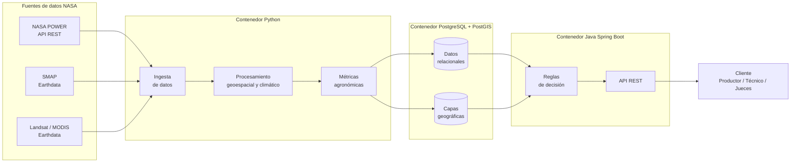

# TerraShift — Field Shift: Adapting Farms with NASA Data

> Sistema de Apoyo a la Toma de Decisiones (DSS) para comparar estrategias de rotación de cultivos frente a la sequía y la degradación del suelo, usando datos satelitales y climáticos de la NASA.

**NASA Space Apps Challenge 2026** · Reto: *Field Shift: Adapting Farms with NASA Data*
**Equipo:** Los zzz · **Sede:** Managua, Nicaragua
**Caso piloto:** Corredor Seco de Nicaragua (maíz y frijol)

| Estado | Fase |
|---|---|
| Investigación científica y agronómica | Completada |
| Arquitectura y documentación base | Este documento |
| Implementación del MVP | Por iniciar |

---

## Tabla de contenidos

1. [Resumen ejecutivo e impacto](#1-resumen-ejecutivo-e-impacto)
2. [Metodología de análogos regionales](#2-metodología-de-análogos-regionales)
3. [Arquitectura del sistema](#3-arquitectura-del-sistema)
4. [Estructura del repositorio](#4-estructura-propuesta-del-repositorio)
5. [Matriz de estrategias de rotación](#5-matriz-de-estrategias-de-rotación)
6. [Roadmap de desarrollo (MVP)](#6-roadmap-de-desarrollo-mvp)
7. [Puesta en marcha](#7-puesta-en-marcha-objetivo)
8. [Fuentes de datos NASA](#8-fuentes-de-datos-nasa)
9. [Alcance y limitaciones](#9-alcance-y-limitaciones)
10. [Equipo y licencia](#10-equipo-y-licencia)

---

## 1. Resumen ejecutivo e impacto

### El problema

El **Corredor Seco** es una franja de bosque tropical seco que atraviesa Centroamérica y abarca buena parte del Pacífico y el centro-norte de Nicaragua. Allí, miles de familias dependen de la agricultura de subsistencia de **granos básicos** (maíz y frijol) cultivada en secano, es decir, sin riego y sujeta al régimen de lluvias.

Los problemas que enfrentan los pequeños productores se refuerzan entre sí:

- **Variabilidad climática creciente:** retrasos en el inicio de la temporada de lluvias, canícula (veranillo) más prolongada y eventos de sequía asociados a El Niño.
- **Degradación del suelo:** pérdida de materia orgánica, erosión y baja retención de humedad, agravadas por prácticas de monocultivo y quema.
- **Información de decisión limitada:** la mayoría de los productores no cuenta con herramientas que traduzcan datos climáticos y satelitales en recomendaciones concretas sobre **qué sembrar, cuándo y con qué prácticas**.
- **Escasez de series históricas hiperlocales abiertas** en el país, lo que dificulta calibrar modelos agronómicos solo con datos nacionales.

### Nuestra solución

TerraShift es un **DSS (Decision Support System)** que cruza datos de observación de la Tierra de la NASA con parámetros edáficos para **comparar, bajo un mismo marco cuantitativo, tres estrategias de rotación de cultivos**: una línea base tradicional, una orientada a la conservación hídrica y una orientada a la regeneración de suelos.

El sistema responde a la pregunta central del productor y del técnico de extensión:

> *Dadas las condiciones climáticas y de suelo de mi zona, ¿qué estrategia de rotación reduce mejor mi riesgo frente a la sequía y mejora la salud de mi suelo a mediano plazo?*

### Cómo usamos los datos de la NASA

| Fuente | Aporte al modelo |
|---|---|
| **NASA POWER** | Precipitación, temperatura, radiación solar y humedad: series climáticas diarias y derivación de índices de sequía y de estrés hídrico. |
| **SMAP** | Humedad de suelo (superficie y zona de raíces): señal directa de disponibilidad de agua para el cultivo. |
| **Landsat / MODIS** | Índices de vegetación (NDVI/EVI), fenología y evapotranspiración: seguimiento del vigor del cultivo y de la cobertura. |

### Impacto esperado

- **Productor y extensionista:** una comparación clara y trazable entre alternativas de manejo, en lugar de decisiones basadas únicamente en la costumbre o en la intuición.
- **Resiliencia climática:** priorizar prácticas que reduzcan la exposición a la sequía y recuperen la capacidad del suelo para retener agua.
- **Escalabilidad:** la metodología no depende de una sola finca; puede replicarse en otras zonas del Corredor Seco y de Centroamérica incorporando nuevos análogos.
- **Ciencia abierta:** uso exclusivo de datos abiertos y de código reproducible.

---

## 2. Metodología de análogos regionales

### Por qué análogos

En Nicaragua **no existen series históricas abiertas y hiperlocales** (a escala de parcela) de rendimientos, humedad de suelo medida en campo y ensayos de rotación de largo plazo. Para no depender de datos que no tenemos, **transferimos evidencia** desde regiones de América Latina con condiciones climáticas y edáficas comparables, donde ya se han documentado intervenciones de manejo con resultados medibles.

### Principio

> Si dos regiones comparten un **régimen de aridez/sequía** y una **condición de suelo** similares, la respuesta de un cultivo a una estrategia de manejo documentada en una región es una **hipótesis razonable y verificable** para la otra.

### Pasos del método

```
1. Caracterizar el sitio piloto        ->  clima (NASA POWER), humedad (SMAP), vegetación (Landsat/MODIS), suelo
2. Seleccionar regiones análogas       ->  similitud climática y edáfica (criterios de la sección 2.1)
3. Extraer evidencia de las análogas   ->  efecto de cada estrategia sobre rendimiento, humedad y suelo
4. Transferir con factores de ajuste   ->  corrección por diferencias entre análoga y piloto
5. Simular y comparar estrategias      ->  indicadores de la matriz (sección 5) con intervalos de incertidumbre
6. Validar contra señal satelital      ->  consistencia con NDVI/SMAP observados en el piloto
```

### 2.1 Criterios de selección de una región análoga

Una región entra al conjunto de análogos si cumple **todos** los criterios obligatorios y la mayor parte de los deseables.

| Criterio | Tipo | Descripción |
|---|---|---|
| Régimen de precipitación | Obligatorio | Precipitación anual y estacionalidad comparables (temporada húmeda y seca marcadas). |
| Déficit hídrico | Obligatorio | Índice de aridez o de sequía en un rango similar al del piloto. |
| Condición edáfica | Obligatorio | Suelos degradados con textura, materia orgánica y erosión comparables. |
| Cultivos | Deseable | Granos básicos o cultivos con respuesta fisiológica comparable. |
| Intervención documentada | Obligatorio | Evidencia publicada de una intervención con resultados medibles. |
| Escala de productor | Deseable | Agricultura de pequeña escala. |

### 2.2 Registro de análogos

> Falta completar con el resultado de la investigación. Cada fila debe tener una referencia verificable en `docs/referencias.md`.

| ID | Región análoga | País | Rasgo climático | Rasgo edáfico | Estrategia evidenciada | Referencia |
|---|---|---|---|---|---|---|
| A1 | `[COMPLETAR]` | `[COMPLETAR]` | `[COMPLETAR]` | `[COMPLETAR]` | `[COMPLETAR]` | `[COMPLETAR]` |
| A2 | `[COMPLETAR]` | `[COMPLETAR]` | `[COMPLETAR]` | `[COMPLETAR]` | `[COMPLETAR]` | `[COMPLETAR]` |
| A3 | `[COMPLETAR]` | `[COMPLETAR]` | `[COMPLETAR]` | `[COMPLETAR]` | `[COMPLETAR]` | `[COMPLETAR]` |

### 2.3 Transferencia de evidencia

La evidencia no se copia: se **ajusta**. Para cada análoga se define un factor de transferencia que corrige las diferencias medibles con el piloto:

```
efecto_piloto = efecto_analogo × f_clima × f_suelo × f_cultivo
```

- `f_clima`: razón de índices de estrés hídrico (POWER/SMAP) entre piloto y análoga.
- `f_suelo`: razón de capacidad de retención y materia orgánica entre piloto y análoga.
- `f_cultivo`: ajuste por especie/variedad cuando el cultivo difiere.

Cada efecto transferido se reporta **con un intervalo de incertidumbre** y con la lista de análogos que lo sustentan. Las reglas de decisión del backend usan estos intervalos, no valores puntuales.

### 2.4 Cómo se valida

- **Consistencia satelital:** las tendencias simuladas deben ser coherentes con el NDVI/EVI y la humedad de suelo observados en el piloto durante años secos y años normales.
- **Análisis de sensibilidad:** se mide cuánto cambia el ranking de estrategias al variar los factores de transferencia.
- **Transparencia:** el sistema muestra siempre qué análogos respaldan cada recomendación.

---

## 3. Arquitectura del sistema

Sistema híbrido, encapsulado en contenedores **Docker** y orquestado con **Docker Compose**. Cada servicio tiene una responsabilidad única y se comunica con los demás por interfaces explícitas.

### Diagrama de flujo



### Responsabilidades por servicio

| Servicio | Tecnología | Responsabilidad |
|---|---|---|
| `python-etl` | Python 3.11+ | Ingesta de las APIs de la NASA, limpieza, procesamiento geoespacial y climático, cálculo de métricas agronómicas y carga a la base de datos. |
| `java-backend` | Java 21 + Spring Boot | Lógica de negocio, motor de reglas de decisión, comparación de estrategias, exposición de la API REST y gestión de datos. |
| `database` | PostgreSQL + PostGIS | Almacenamiento de datos relacionales (parcelas, estrategias, resultados) y capas geográficas (zonas, rasters vectorizados, límites). |

### Contrato entre servicios

- **ETL → Base de datos:** el ETL es el **único** servicio que escribe en las tablas de datos crudos y de métricas (`raw_*`, `metrics_*`). Las cargas son idempotentes.
- **Backend → Base de datos:** el backend **lee** métricas y **escribe** únicamente resultados de comparación y datos de aplicación (`app_*`).
- **Backend → Cliente:** API REST documentada con OpenAPI/Swagger (`/docs/api`).
- Los servicios no se llaman entre sí directamente: **la base de datos es el punto de integración**. Esto permite que el equipo desarrolle ETL y backend en paralelo.

### Modelo de datos (borrador)

| Tabla | Contenido |
|---|---|
| `zone` | Zona/municipio del piloto (geometría PostGIS). |
| `climate_daily` | Serie diaria de variables climáticas por zona (origen NASA POWER). |
| `soil_moisture` | Humedad de suelo por zona y fecha (origen SMAP). |
| `vegetation_index` | NDVI/EVI por zona y fecha (origen Landsat/MODIS). |
| `soil_profile` | Parámetros edáficos por zona. |
| `crop` | maíz, frijol y parámetros de ciclo. |
| `strategy` | Las 3 estrategias de rotación y su definición. |
| `analog_region` | Regiones análogas y sus referencias. |
| `strategy_result` | Resultado de cada estrategia por zona y escenario. |

---

## 4. Estructura propuesta del repositorio

```
TerraShift/
├── README.md
├── docker-compose.yml
├── .env.example
├── .gitignore
│
├── python-etl/                 # Motor analítico / ETL
│   ├── Dockerfile
│   ├── pyproject.toml
│   ├── src/
│   │   ├── ingest/             # Clientes NASA POWER, SMAP, Landsat/MODIS
│   │   ├── process/            # Limpieza, geoprocesamiento, índices de sequía
│   │   ├── metrics/            # Métricas agronómicas por estrategia
│   │   └── load/               # Carga idempotente a PostgreSQL/PostGIS
│   └── tests/
│
├── java-backend/               # Backend core (Spring Boot)
│   ├── Dockerfile
│   ├── pom.xml
│   └── src/
│       ├── main/java/.../
│       │   ├── api/            # Controladores REST
│       │   ├── domain/         # Entidades y reglas de decisión
│       │   ├── service/        # Comparación de estrategias
│       │   └── repository/     # Acceso a datos
│       └── test/
│
├── database/                   # Base de datos
│   ├── init/                   # Scripts SQL de inicialización (esquema, PostGIS)
│   ├── migrations/             # Migraciones versionadas
│   └── seeds/                  # Datos semilla (cultivos, estrategias, análogos)
│
├── data/                       # Datos locales (ignorado por git, salvo muestras)
│   └── samples/
│
└── docs/                       # Documentación
    ├── metodologia.md          # Detalle de la metodología de análogos
    ├── referencias.md          # Bibliografía y fuentes verificables
    ├── api/                    # Especificación OpenAPI
    ├── arquitectura/           # Decisiones de diseño
    └── img/                    # Diagramas y capturas
```

**Convenciones del equipo**

- Una rama por funcionalidad: `feat/etl-power`, `feat/api-estrategias`, `fix/...`.
- Pull requests pequeños y revisados por al menos otra persona.
- Ningún secreto en el repositorio: credenciales de NASA Earthdata y de la base de datos van en `.env` (ver `.env.example`).

---

## 5. Matriz de estrategias de rotación

Las tres estrategias se evalúan con **los mismos indicadores y los mismos escenarios climáticos** (año normal, año seco, año con canícula prolongada), de modo que la comparación sea justa.

### 5.1 Definición de las estrategias

| | **E1 · Línea base tradicional** | **E2 · Conservación hídrica** | **E3 · Regeneración de suelos** |
|---|---|---|---|
| **Enfoque** | Práctica actual del productor. | Maximizar el aprovechamiento y retención de agua. | Recuperar materia orgánica y estructura del suelo. |
| **Rotación / secuencia** | `[COMPLETAR]` | `[COMPLETAR]` | `[COMPLETAR]` |
| **Prácticas clave** | `[COMPLETAR]` | `[COMPLETAR]` | `[COMPLETAR]` |
| **Cultivos involucrados** | `[COMPLETAR]` | `[COMPLETAR]` | `[COMPLETAR]` |
| **Análogos que la respaldan** | `[A1, A2 ...]` | `[A1, A2 ...]` | `[A1, A2 ...]` |

### 5.2 Matriz comparativa de resultados

> Valores a rellenar con las métricas finales del motor analítico. Reportar siempre `valor [mín – máx]` para reflejar la incertidumbre.

| Indicador | Unidad | Fuente principal | E1 · Línea base | E2 · Conservación hídrica | E3 · Regeneración de suelos |
|---|---|---|---|---|---|
| Rendimiento esperado, año normal | t/ha | Análogos + POWER | `[ ]` | `[ ]` | `[ ]` |
| Rendimiento esperado, año seco | t/ha | Análogos + POWER + SMAP | `[ ]` | `[ ]` | `[ ]` |
| Variabilidad interanual del rendimiento | % | Escenarios | `[ ]` | `[ ]` | `[ ]` |
| Índice de estrés hídrico del cultivo | 0–1 | POWER + SMAP | `[ ]` | `[ ]` | `[ ]` |
| Humedad de suelo en zona de raíces (media del ciclo) | m³/m³ | SMAP | `[ ]` | `[ ]` | `[ ]` |
| Vigor de vegetación (NDVI pico) | 0–1 | Landsat / MODIS | `[ ]` | `[ ]` | `[ ]` |
| Cobertura del suelo en época seca | % | Landsat / MODIS | `[ ]` | `[ ]` | `[ ]` |
| Riesgo de pérdida de cosecha por sequía | % | Escenarios | `[ ]` | `[ ]` | `[ ]` |
| Tendencia de materia orgánica del suelo (5 años) | Δ % | Análogos | `[ ]` | `[ ]` | `[ ]` |
| Riesgo de erosión | bajo/medio/alto | Suelo + cobertura | `[ ]` | `[ ]` | `[ ]` |
| Costo de implementación | USD/ha | Análisis económico | `[ ]` | `[ ]` | `[ ]` |
| Plazo para ver beneficios | años | Análogos | `[ ]` | `[ ]` | `[ ]` |
| **Puntaje global de decisión** | 0–100 | Reglas del backend | `[ ]` | `[ ]` | `[ ]` |
| **Nivel de confianza** | alto/medio/bajo | Nº y calidad de análogos | `[ ]` | `[ ]` | `[ ]` |

### 5.3 Regla de decisión (borrador)

El backend calcula un **puntaje global** como suma ponderada de indicadores normalizados:

```
puntaje(E) = Σ  w_i × indicador_normalizado_i(E)
```

- Los pesos `w_i` son **configurables** (por ejemplo: priorizar resiliencia a la sequía frente a costo).
- Se reporta también el **nivel de confianza** según el número y la calidad de los análogos que respaldan la estrategia.
- Pesos por defecto: `[COMPLETAR TRAS LA VALIDACIÓN CON EL EQUIPO]`.

---

## 6. Roadmap de desarrollo (MVP)

Prioridad: tener un **flujo completo de extremo a extremo** (aunque simple) lo antes posible, y luego profundizar.

### Fase 0 · Cimientos
- [ ] Definir convenciones de ramas y revisión de código
- [ ] Crear `docker-compose.yml` con los tres servicios y red compartida
- [ ] Crear `.env.example` y documentar variables de entorno
- [ ] Registrar cuenta en NASA Earthdata y compartir el método de credenciales con el equipo
- [ ] Verificar que `docker compose up` levanta los tres contenedores vacíos

### Fase 1 · Base de datos
- [ ] Contenedor PostgreSQL con extensión PostGIS habilitada
- [ ] Esquema inicial (`zone`, `climate_daily`, `soil_moisture`, `vegetation_index`, `soil_profile`, `crop`, `strategy`, `analog_region`, `strategy_result`)
- [ ] Datos semilla: cultivos, las 3 estrategias y el registro de análogos
- [ ] Definir y cargar la geometría de la(s) zona(s) piloto

### Fase 2 · Motor analítico (Python)
- [ ] Cliente de NASA POWER (serie diaria por zona)
- [ ] Cliente de SMAP (humedad de suelo)
- [ ] Cliente de Landsat/MODIS (NDVI/EVI)
- [ ] Limpieza y agregación temporal/espacial
- [ ] Cálculo de índices de sequía y de estrés hídrico
- [ ] Cálculo de métricas por estrategia con factores de transferencia
- [ ] Carga idempotente a PostgreSQL/PostGIS
- [ ] Pruebas unitarias de las métricas clave

### Fase 3 · Backend (Spring Boot)
- [ ] Proyecto base con conexión a PostgreSQL/PostGIS
- [ ] Entidades y repositorios
- [ ] Motor de reglas: puntaje global y nivel de confianza
- [ ] Endpoints REST: zonas, series, estrategias, comparación
- [ ] Documentación OpenAPI/Swagger
- [ ] Pruebas de los endpoints principales

### Fase 4 · Visualización y demo
- [ ] Interfaz mínima que consuma la API (selector de zona/cultivo y comparación de las 3 estrategias)
- [ ] Mapa de la zona piloto con capa de índice de vegetación o humedad
- [ ] Gráficas comparativas por escenario (normal / seco / canícula)
- [ ] Mostrar siempre los análogos y la incertidumbre detrás de cada resultado

### Fase 5 · Cierre y entrega
- [ ] Rellenar la matriz de la sección 5 con los resultados finales
- [ ] Completar `docs/referencias.md` con todas las fuentes
- [ ] Capturas, diagramas finales y video/guion de la demo
- [ ] Revisar que el README refleje el estado real del proyecto
- [ ] Ensayo de la presentación y envío del proyecto en la plataforma de Space Apps

> **Regla de corte:** si el tiempo se agota, el MVP mínimo defendible es **Fases 0, 1, 2 y 3** con una **comparación visible de las 3 estrategias** (aunque sea con una interfaz muy simple).

---

## 7. Puesta en marcha (objetivo)

> Esta sección describe el resultado esperado; se actualizará conforme el código exista.

```bash
# 1. Clonar
git clone https://github.com/Rrodrovan/TerraShift.git
cd TerraShift

# 2. Configurar variables de entorno
cp .env.example .env
# Editar .env con credenciales de NASA Earthdata y de la base de datos

# 3. Levantar todos los servicios
docker compose up --build

# 4. Ejecutar la ingesta inicial (ejemplo)
docker compose run --rm python-etl python -m src.cli ingest --zone piloto

# 5. Consultar la API
curl http://localhost:8080/api/v1/strategies/compare?zone=piloto
```

**Variables de entorno previstas**

| Variable | Descripción |
|---|---|
| `POSTGRES_DB` / `POSTGRES_USER` / `POSTGRES_PASSWORD` | Credenciales de la base de datos. |
| `EARTHDATA_USERNAME` / `EARTHDATA_PASSWORD` | Credenciales de NASA Earthdata (SMAP, Landsat/MODIS). |
| `PILOT_ZONE_BBOX` | Caja geográfica de la zona piloto. |
| `ETL_START_DATE` / `ETL_END_DATE` | Rango temporal de ingesta. |

---

## 8. Fuentes de datos NASA

| Fuente | Qué aporta | Acceso |
|---|---|---|
| NASA POWER | Meteorología y radiación solar diaria en cuadrícula global | API REST pública |
| SMAP | Humedad de suelo (superficie y zona de raíces) | NASA Earthdata (requiere cuenta) |
| Landsat | Reflectancia superficial a 30 m (NDVI) | NASA Earthdata / USGS |
| MODIS | Índices de vegetación y evapotranspiración | NASA Earthdata (LP DAAC) |

Todos los datos de NASA se usan conforme a sus políticas de datos abiertos, con la atribución correspondiente.

---

## 9. Alcance y limitaciones

Esta sección separa lo que el proyecto **sí hace** de lo que **no hace**, y para cada limitación indica su impacto y cómo la mitigamos.

### 9.1 Alcance

| Dimensión | Dentro del alcance (MVP) | Fuera del alcance (por ahora) |
|---|---|---|
| **Territorio** | Corredor Seco de Nicaragua, zona(s) piloto | Otros países o regiones húmedas |
| **Cultivos** | maíz y frijol | Hortalizas, café, frutales, ganadería |
| **Estrategias** | Las 3 estrategias de rotación definidas (sección 5) | Prácticas no incluidas en la investigación |
| **Escala espacial** | Zona / municipio | Parcela individual |
| **Datos** | NASA POWER, SMAP, Landsat/MODIS y parámetros edáficos | Datos de campo propios de productores |
| **Resultado** | Comparación cuantitativa con incertidumbre | Recomendaciones agronómicas personalizadas o prescriptivas |
| **Usuarios** | Técnicos de extensión, productores asistidos y evaluadores | Uso comercial o certificación |

### 9.2 Limitaciones, impacto y mitigación

| # | Limitación | Impacto en los resultados | Mitigación |
|---|---|---|---|
| L1 | No hay series históricas hiperlocales abiertas en Nicaragua | Los efectos de cada estrategia no se calibran con ensayos locales | Transferencia desde análogos con factores de ajuste (sección 2.3) |
| L2 | La evidencia proviene de regiones análogas, no del piloto | Posible sesgo si la análoga difiere en rasgos no medidos | Criterios de selección explícitos y análisis de sensibilidad |
| L3 | SMAP tiene resolución gruesa (decenas de km) | No distingue diferencias entre parcelas vecinas | Trabajar a escala de zona y complementar con NDVI de Landsat/MODIS |
| L4 | Los parámetros edáficos tienen cobertura y detalle limitados | Menor precisión en retención de agua y materia orgánica | Reportar rangos, no valores puntuales |
| L5 | Los resultados son estimaciones, no mediciones | Pueden no reflejar un año o finca concreta | Intervalos de incertidumbre y nivel de confianza en cada resultado |
| L6 | El tiempo del hackathon limita la validación | Validación parcial contra señal satelital | Priorizar validación de las métricas clave y documentar lo pendiente |

### 9.3 Uso responsable

- TerraShift es una herramienta de **apoyo a la decisión**, no sustituye la asesoría de un técnico agrónomo.
- Toda recomendación muestra los análogos y la incertidumbre que la respaldan.

### 9.4 Trabajo futuro

- Incorporar datos de campo de productores.
- Validar con ensayos locales en el Corredor Seco.
- Ampliar a otros cultivos y países de la región.

---

## 10. Equipo y licencia

**Equipo "Los zzz"** — sede Managua, Nicaragua.

| Integrante | Rol |
|---|---|
| `Rodrigo Ivan Ramírez Dávalos` | `Desarrollador` |
| `[COMPLETAR]` | `[COMPLETAR]` |
| `[COMPLETAR]` | `[COMPLETAR]` |
| `[COMPLETAR]` | `[COMPLETAR]` |

**Licencia:** `[Espacio para las licencias]`

---

*NASA Space Apps Challenge 2026. Este proyecto fue desarrollado en el marco del hackathon y no está afiliado ni respaldado oficialmente por la NASA.*
